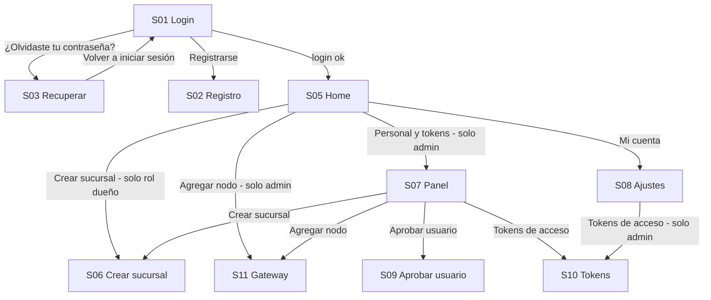

# Flujos y comportamiento por pantalla

> Cómo llenarlo: una sección por pantalla. Si algo no aplica, escribe `—`.
> Si no lo sabes o es decisión pendiente, escribe `?` y te lo pregunto después en bloque.
> No hace falta que esté bonito ni completo: con la mitad llena ya puedo empezar.

## 1. Mapa global

El mapa de abajo está **sacado del código actual** (`src/app/AppNavigator.js` y los `go('...')` de cada
pantalla). Corrígelo donde el diseño nuevo cambie algo: pantallas nuevas, pantallas que desaparecen,
pantallas que se fusionan.

Pantallas que existen en el código pero no aparecen en el mapa porque nadie navega a ellas todavía:
`alerts` (PlaceholderScreen).

## 2. Tabla de pantallas

| ID | Frame en Figma | Ruta en código | Rol mínimo | Estado |
|---|---|---|---|---|
| S01 | Login | `login` | público | |
| S02 | Registro | `register` | público | |
| S03 | Recuperar contraseña | `recovery` | público | |
| S05 | Home | `home` | usuario | |
| S06 | Crear sucursal | `branch` | dueño de empresa | |
| S07 | Panel de administración | `panel` | admin | |
| S08 | Ajustes / Mi cuenta | `settings` | usuario | |
| S09 | Aprobar usuario | `approve` | admin | |
| S10 | Tokens de acceso | `tokens` | admin | |
| S11 | Gateway / Agregar nodo | `gateway` | admin | |
| — | | | | |

En "Estado" marca: `rediseño` · `igual al actual` · `nueva` · `eliminar`.

## 3. Ficha por pantalla

Copiá este bloque por cada pantalla. Borrá el ejemplo cuando ya no lo necesites.

---

### S01 · Login

- **PNG:** `screens/S01-login.png`
- **Ruta:** `login` (pública)
- **Entra desde:** arranque de la app sin sesión · `S03` (volver) · logout desde `S08`
- **Sale hacia:** `S02` (Registrarse) · `S03` (¿Olvidaste tu contraseña?) · `S05` (login ok)
- **Estados:** normal · cargando (botón deshabilitado) · error credenciales · error de red
- **Datos:** `POST /auth/login` → token + perfil con rol
- **Interacciones:** tap en "Registrarse" y "¿Olvidaste tu contraseña?" · teclado: el CTA sube con el teclado
- **Validaciones:** correo con formato válido · contraseña mínimo 8 · botón deshabilitado hasta que ambos tengan contenido
- **Edge cases:** cuenta pendiente de aprobación → mensaje específico, no error genérico
- **Notas visuales:** logo centrado arriba, ancho del formulario =

---

### S__ · Nombre

- **PNG:** `screens/S__-slug.png`
- **Ruta:**
- **Entra desde:**
- **Sale hacia:**
- **Estados:**
- **Datos:**
- **Interacciones:**
- **Validaciones:**
- **Edge cases:**
- **Notas visuales:**

## 4. Estado de implementación (frames 01–04)

Implementado con los frames del archivo, sin tocar Alertas (frames 05).

| Frame | ID | Ruta | Archivo |
|---|---|---|---|
| 01 · Login | `20:4` | `login` | `src/screens/auth/LoginScreen.js` |
| 02 · Recuperar contraseña | `20:22` | `recovery` | `src/screens/auth/RecoveryScreen.js` |
| 03 · Registrar usuario | `48:79` | `register` | `src/screens/auth/RegisterScreen.js` |
| 04 · Ajustes | `20:95` | `settings` | `src/screens/settings/SettingsScreen.js` |
| 04.1 · Datos personales | `99:519` | `settings-profile` | `src/screens/settings/ProfileSettingsScreen.js` |
| 04.2 · Notificaciones | `99:563` | `settings-notifications` | `src/screens/settings/NotificationsSettingsScreen.js` |
| 04.3 · Seguridad y contraseña | `99:610` | `settings-security` | `src/screens/settings/SecuritySettingsScreen.js` |
| 04.4 · Cerrar sesión | `99:648` | `settings-logout` | `src/screens/settings/LogoutScreen.js` |
| Tarjeta de resultado (éxito/error) | `84:720`, `52:717` | componente | `src/components/FeedbackDialog.js` |

Navegación de Ajustes: `settings` → `settings-profile` / `settings-notifications` / `settings-security` / `settings-logout`.
Todas vuelven con `go('settings')`. El bottom nav se mantiene visible en las cuatro.

### Operaciones del backend y su retroalimentación

Contrato real leído en `backend-proyecto-2026_2/app/`. La columna "Diálogo" dice si la
operación usa `FeedbackDialog`.

| Operación | Endpoint | Éxito | Errores | Diálogo |
|---|---|---|---|---|
| Iniciar sesión | `POST /auth/login` | 200 token | 401 credenciales · 403 cuenta no aprobada | inline (no modal) |
| Registrar usuario | `POST /auth/register` | 201 | 400 token inválido · 409 correo repetido · 422 validación | sí |
| Crear sucursal | `POST /branches` | 201 + `branch_token` | 400 token global · 403 sin permiso | sí → luego token |
| Aprobar usuario | `POST /auth/approve/{id}` | 200 | 404 no pendiente · 403 sin permiso | sí |
| Token de sucursal | `POST /branches/{id}/token` | 200 | 404 sucursal · 403 sin permiso | sí → luego token |
| Token de empresa | `POST /businesses/{id}/token` | 200 | 403 solo SUDO · 404 empresa | sí → luego token |
| Consultar gateway | `GET /gateways/{id}` | 200 | 403/404 | sí (conectada / desconectada) |
| Comando a gateway | `POST /gateways/{id}/commands` | `ok:true` | 502 sin confirmación | sí |
| Listar gateways | `GET /gateways` | 200 | — | no usado en la app |
| Listar nodos | `GET /branches/{id}/nodes` | 200 | 404/403 | no usado en la app |

### Funciones que el backend NO tiene (pantallas en modo lectura)

| Pantalla | Falta | Estado en la app |
|---|---|---|
| 04.1 Datos personales | endpoint de actualización de perfil | campos de solo lectura, CTA deshabilitado |
| 04.3 Seguridad | endpoint de cambio de contraseña | formulario oculto, solo aviso |
| 04.2 Notificaciones | endpoint de preferencias | toggles en memoria de sesión |
| 02 Recuperar contraseña | envío de correos | diálogo informativo |

`src/services/settingsService.js` expone `CAPABILITIES`; al existir los endpoints se pone
la bandera en `true` y las pantallas se habilitan sin más cambios.

### Pendiente por decisión de diseño

- Contraste de la tarjeta de resultado (`#86FF79` y `#FC0307` sobre `#49769F`).
- Inter vs Roboto en los títulos.
- El frame `48:79` (Registrar usuario) usa la escala vieja (inputs de 267, labels de 20/28);
  se implementó con la escala nueva de Login/Ajustes.
- `03 ·Registrar usuario-OK` (`50:542`) no tiene estado de éxito diseñado; se usa la tarjeta de resultado.
